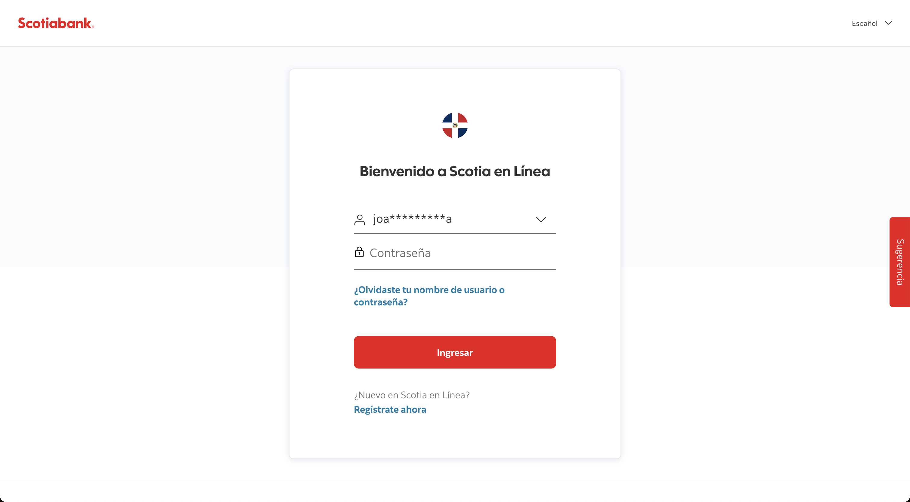
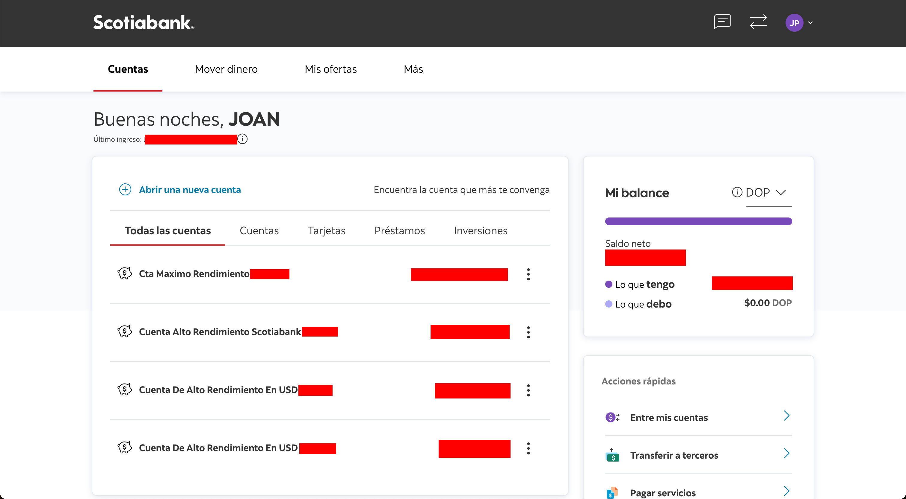

# Scotiabank

### [Online banking platform](http://banking.online.scotiabank.com/account?country=DO&language=es)

Created and maintained high-performance code with 90%+ test coverage, improving a growing React.js codebase through optimized algorithms, faster load/response times, payment integrations, and best practices for an international internet banking platform.

Built secure login and dashboard features for a major Latin American online banking service.

#### Technologies

- [ Node.js](https://nodesjs.org/)
- [ React.js](https://react.dev/)
- [Web Content Accessibility Guidelines](https://developer.mozilla.org/en-US/docs/Web/Accessibility)
- Enterprise API integration
- A/B Testing, Feature toggling

**Screenshots**:

